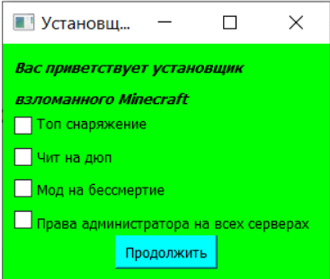
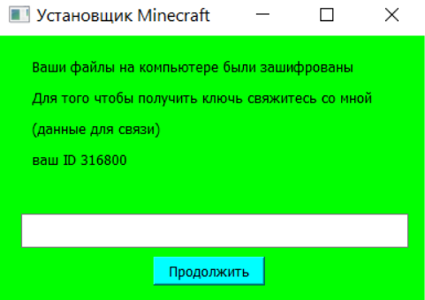

## Ransomware

Этот прототип программы для изучения механизмов шифрования был написан в учебных целях на первом курсе в институте в 2023 году. Код был предназначен для защиты курсовой работы. Он недостаточно оптимизирован, поэтому спустя 3 года я внёс небольште поправки в него для его стабильной работы и переписал README чтобы показать всем заинтересованным то, с чего я начинал.
^_^

Одна из первых моих работ, смотря на которую спустя время мне немного стыдно.

## Подготовка и запуск

Перед запуском создайте тестовую директорию в домашней папке:

```
~/TEST
```

или на Windows:

```
C:\Users\<username>\TEST
```

В файле sms.py необходимо указать:
 - адрес электронной почты
 - ключ приложения (если используется)

Это необходимо для того чтобы данные для расшифровки приходили на почту.

Для того чтобы собрать проект воспользуемся Auto-Py-to-Exe. Это графическая оболочка для PyInstaller, который дает возможность конвертировать python файлы в исполняемые файлы Windows.

Шаги:

Установите:
```
pip install auto-py-to-exe
```

Запустите:

```
auto-py-to-exe
```

Выберите main.py файл проекта

Настройте параметры (по необходимости)

Конвертируйет файл в исполняемый

## Интерфейс

После запуска приложения появится стартовое окно:



После нажатия кнопки "Продолжить":

